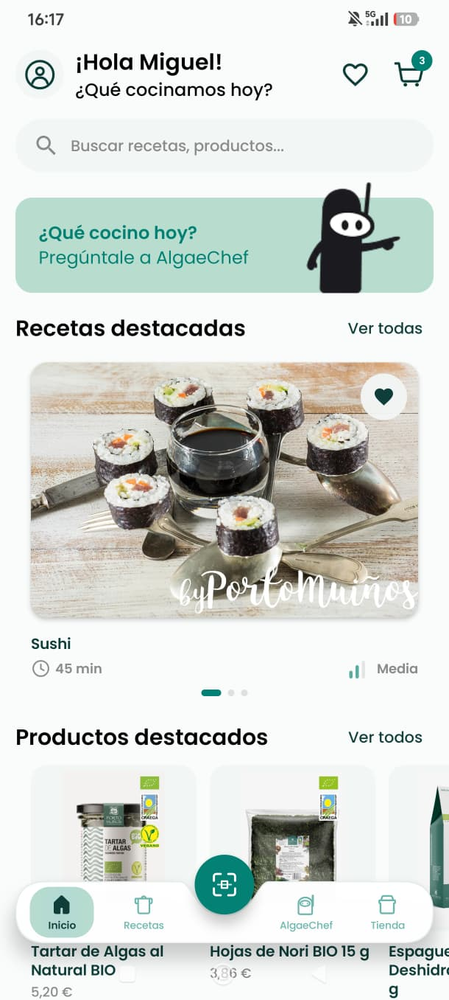
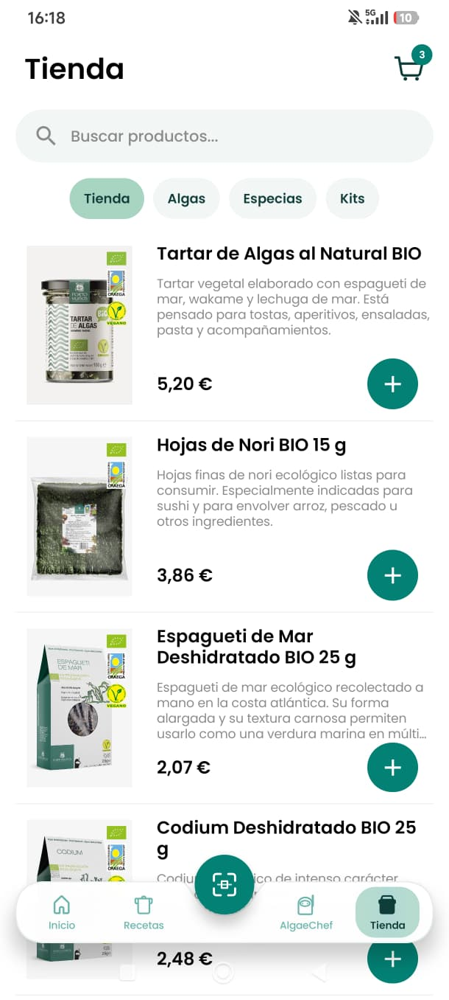
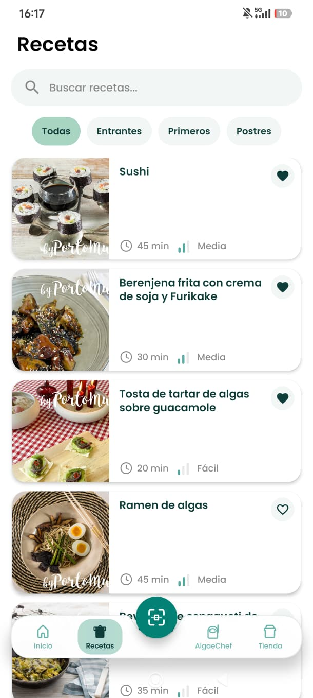
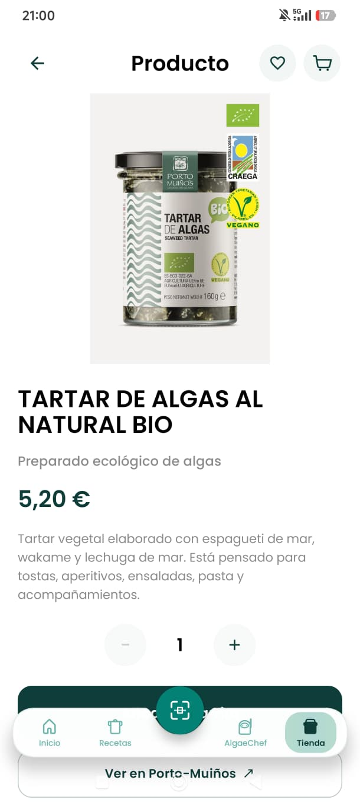
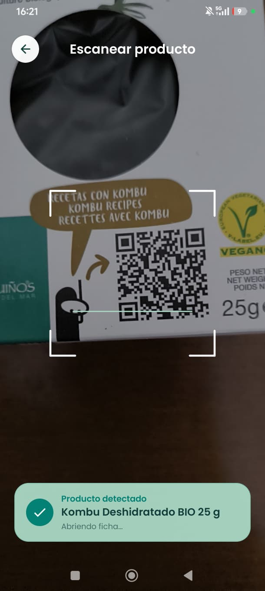
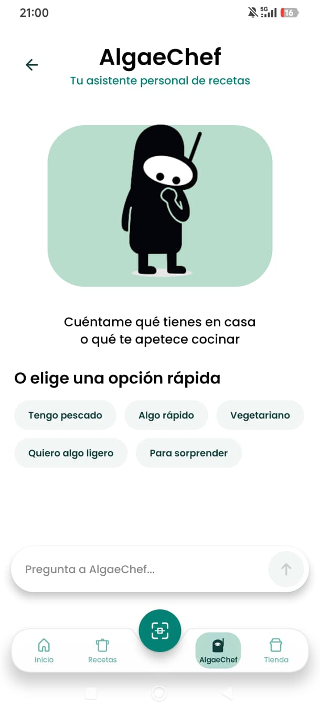

# Porto-Muíños App

Aplicación móvil Android desarrollada como Proyecto Fin de Ciclo de Desarrollo de Aplicaciones Multiplataforma (DAM).

El proyecto nace a partir de un reto propuesto por **Porto-Muiños** dentro del programa InnovaTech FP y evoluciona hacia una implementación Android funcional orientada a facilitar el descubrimiento, uso culinario y compra de productos relacionados con las algas y las verduras del mar.

## Capturas

<table>
  <tr>
    <td align="center">
      <br>
      <sub>Inicio</sub>
    </td>
    <td align="center">
      <br>
      <sub>Productos</sub>
    </td>
    <td align="center">
      <br>
      <sub>Recetas</sub>
    </td>
  </tr>
  <tr>
    <td align="center">
      <br>
      <sub>Detalle de producto</sub>
    </td>
    <td align="center">
      <br>
      <sub>Escáner QR</sub>
    </td>
    <td align="center">
      <br>
      <sub>AlgaeChef</sub>
    </td>
  </tr>
</table>

## Funcionalidades

- Registro e inicio de sesión mediante correo electrónico.
- Confirmación de correo y recuperación de contraseña.
- Autenticación mediante Google OAuth.
- Catálogo de productos conectado a Supabase.
- Recetario con ingredientes, preparación y productos relacionados.
- Búsqueda y filtrado de productos y recetas.
- Favoritos persistentes por usuario.
- Carrito persistente con gestión de cantidades.
- Integración con la tienda oficial de Porto-Muiños.
- Escaneo de códigos QR mediante cámara.
- Navegación entre productos y recetas relacionadas.
- Perfil de usuario y gestión de cuenta.
- AlgaeChef, demostrador funcional de asistente culinario basado en recomendaciones controladas.

## Tecnologías

- **Kotlin**
- **Jetpack Compose**
- **Material 3**
- **MVVM**
- **Repository Pattern**
- **Supabase**
  - PostgreSQL
  - Auth
  - Storage
  - Edge Functions
  - Row Level Security
- **CameraX**
- **Google ML Kit**
- **Navigation Compose**
- **Coil**
- **Kotlin Serialization**
- **Ktor**

## Arquitectura

La aplicación utiliza una arquitectura **MVVM + Repository**, separando la interfaz, el estado de presentación y el acceso a datos.

Supabase actúa como backend y proporciona autenticación, persistencia PostgreSQL, almacenamiento de imágenes y servicios serverless.

Los datos privados asociados al usuario, como favoritos y carrito, se protegen mediante políticas **Row Level Security (RLS)**.

## Requisitos

- Android 8.0 o superior.
- API mínima: 26.
- Conexión a Internet para las funcionalidades conectadas al backend.
- Cámara para utilizar el escáner QR.

Para ejecutar el proyecto desde Android Studio se utiliza:

- JDK 21 para Gradle.
- Gradle 8.13.
- compileSdk 36.
- targetSdk 36.
- JVM target 11.

## Configuración

El proyecto necesita las siguientes variables en `local.properties`:

```properties
SUPABASE_URL=https://TU_PROJECT_REF.supabase.co
SUPABASE_KEY=TU_SUPABASE_ANON_KEY
```

El repositorio incluye `local.properties.example` como plantilla.

Las credenciales reales no forman parte del repositorio.

## Documentación

La memoria completa del Proyecto Fin de Ciclo está disponible en:

[Memoria del proyecto](docs/Memoria_Proyecto_Fin_de_Ciclo_Miguel_Fernandez_Gonzalez.pdf)

## APK

La versión final instalable se encuentra disponible en GitHub Releases:

[PortoMuinos v1.0](https://github.com/miguelfdezglez29/PortoMuinos/releases/tag/v1.0)

La release incluye la APK firmada:

`PortoMuinos-v1.0.apk`

## Estado del proyecto

Versión final desarrollada y validada mediante:

- 13 pruebas unitarias.
- Pruebas funcionales.
- Emulador Android.
- Dispositivo físico.
- Inspección estática con Android Studio.

AlgaeChef se implementa en esta versión como un demostrador funcional basado en reglas deterministas. La integración de inteligencia artificial generativa real se contempla como una posible evolución futura.

## Autor

**Miguel Fernández González**  
Proyecto Fin de Ciclo · Desarrollo de Aplicaciones Multiplataforma  
2026
